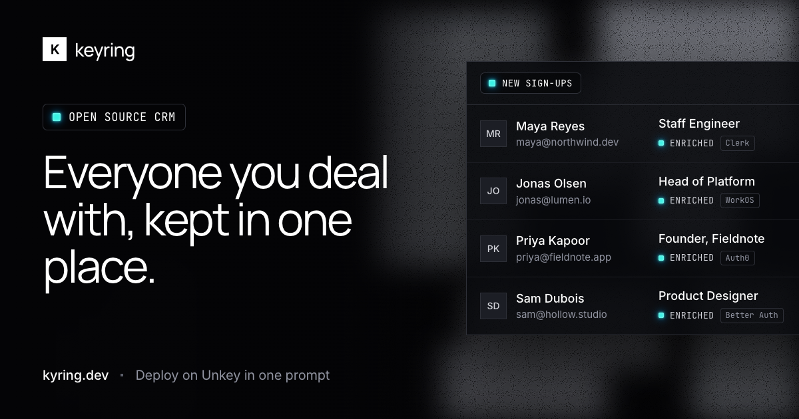

<p align="center">
  
</p>

<h1 align="center">Keyring</h1>

<p align="center">
  Everyone you deal with, kept in one place.<br />
  <a href="https://kyring.dev">Website</a> · <a href="https://kyring.dev/docs/">Docs</a> · <a href="https://kyring.dev/#deploy">Deploy on Unkey</a>
</p>

Keyring is an open source CRM you run yourself. Every person who signs up through your auth provider becomes a contact with a job title and a company, ready for your team in the web UI and for your agents over MCP and REST.

## Why Keyring

- **Sign-ups arrive on their own.** Connect Clerk, WorkOS AuthKit, Better Auth, Supabase Auth, Auth0 or Stytch once, or post sign-ups from any backend. Retries and duplicates land once.
- **Every contact comes with context.** Keyring looks up job titles, locations, company logos, sizes and industries on [context.dev](https://context.dev). Nothing a person edits is ever overwritten.
- **Built for agents.** Claude Code, Cursor and other MCP clients sign in as you in the browser. Backends use scoped API keys that can be read-only and expire.
- **MIT licensed. Yours to run, change and keep.** One container and a Postgres database, on Unkey or any host.
- **Secure by default.** Passkey sign-in, no default password, secrets encrypted at rest.

## Get started

### Deploy on Unkey with one prompt

The fastest way to a running Keyring. Add Unkey's MCP server to your coding agent:

```sh
claude mcp add --transport http unkey https://mcp.unkey.com
```

Then copy the prompt from [kyring.dev](https://kyring.dev/#deploy) into the agent. It asks for your Postgres URL, deploys Keyring to Unkey, and gives you the link to create your account. To do it by hand, follow [Deploy on Unkey](https://kyring.dev/docs/deploy-unkey).

### Run it locally with Docker

You need Docker with Compose v2.

```sh
git clone https://github.com/unkeyed/keyring.git
cd keyring
echo "ENCRYPTION_KEY=$(openssl rand -base64 32)" >> .env
docker compose up -d --build --wait
docker compose logs app | grep -A2 'Open this link'
```

Open the link Keyring prints and register a passkey. Keep `.env`: the `ENCRYPTION_KEY` in it protects the secrets Keyring stores. To run it on your own server, see [Self-host Keyring](https://kyring.dev/docs/self-hosting).

## Connect your auth provider

Open **Settings > Providers** in Keyring, pick your provider, and paste the webhook URL it shows into your provider. Sign up a test user and they appear under **Contacts** within seconds.

[Clerk](https://kyring.dev/docs/providers/clerk) · [WorkOS AuthKit](https://kyring.dev/docs/providers/workos) · [Better Auth](https://kyring.dev/docs/providers/better-auth) · [Supabase Auth](https://kyring.dev/docs/providers/supabase) · [Auth0](https://kyring.dev/docs/providers/auth0) · [Stytch](https://kyring.dev/docs/providers/stytch)

Using something else? Post each sign-up from your backend with an API key:

```sh
curl -X POST https://<your-keyring>/v1/signups \
  -H "Authorization: Bearer $KEYRING_API_KEY" \
  -H "Content-Type: application/json" \
  -d '{"email": "ada@example.com", "name": "Ada Lovelace"}'
```

A provider cannot reach `localhost`. When running Keyring on your laptop, put a tunnel such as `cloudflared tunnel --url http://localhost:8080` in front of it and use the tunnel's URL.

## Connect your agents

```sh
claude mcp add --transport http keyring https://<your-keyring>/mcp
```

There is no key to copy: the first time, your browser opens, you approve the agent, and it acts as you. It can search, update, tag and merge contacts, add notes, read the timeline and queue enrichment. [Agents](https://kyring.dev/docs/agents) covers Cursor, Claude Desktop and the REST API.

## Documentation

| Guide | What it covers |
|---|---|
| [Self-host](https://kyring.dev/docs/self-hosting) | Run Keyring with Docker Compose or on any container host |
| [Deploy on Unkey](https://kyring.dev/docs/deploy-unkey) | Every step of an Unkey deployment |
| [Configuration](https://kyring.dev/docs/configuration) | Every environment variable |
| [Sign-in](https://kyring.dev/docs/sign-in) | Passkeys, Google, GitHub, OIDC, two-factor and recovery |
| [Agents](https://kyring.dev/docs/agents) | MCP clients, the REST API and API keys |

## Contributing

[CONTRIBUTING.md](CONTRIBUTING.md) explains how to run Keyring from source, run the tests, and add an auth provider.

## License

[MIT](LICENSE). Provided by [Unkey](https://www.unkey.com).
